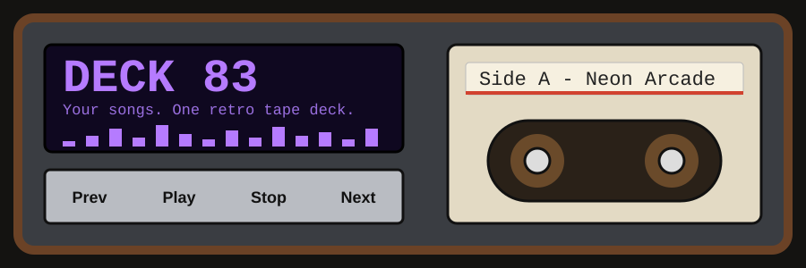

<p align="center">
  
</p>

<h1 align="center">Deck 83</h1>

<p align="center">
  A retro cassette-deck music player for your own songs.<br>
  Spinning reels, a purple spectrum meter, and accounts that work on any device.
</p>

<p align="center">
  <a href="https://stalwart-florentine-ee5f6c.netlify.app"></a>
</p>

<p align="center">
  
  
  
</p>

---

## Try it

**https://stalwart-florentine-ee5f6c.netlify.app**

Create an account with your email, log in, and press Play.

## What it does

| | |
|---|---|
| 📼 **Tape deck look** | Spinning reels, a cassette label that shows the current track, and chunky hardware-style buttons. |
| 🎛️ **Live spectrum meter** | A purple LED meter that moves with the music. |
| 🎵 **Built-in tracks** | Three chiptune songs generated right in the browser, so there is something to play straight away. |
| ➕ **Your own songs** | Add audio files from your device, play them, and delete them with the ✕ button. |
| 👤 **Real accounts** | Sign up once and log in from any device. You stay logged in after closing the page. |
| ⌨️ **Keyboard controls** | Space plays or pauses. Left and right arrows change tracks. |

## How it works

```
index.html   Homepage with About, FAQ, and links to sign up or log in
player.html  Login card and the music player (same page)
config.js    Your Supabase URL and anon key
```

- **Accounts** are handled by [Supabase](https://supabase.com) (email and password).
- **Songs** you add are stored in your browser on the device where you add them. They are never uploaded, so they do not appear on your other devices.
- **Built-in tracks** are made with the Web Audio API.

## Good to know

- Deck 83 plays built-in tracks and audio files from your device. It does not stream from Spotify or other services.
- Any audio your browser can play works, including MP3, WAV, M4A, and OGG.
- Clearing your browser data removes the songs you added on that browser. Your account stays.

## Ideas for later

- [ ] Songs that follow you across devices (Supabase Storage)
- [ ] Shuffle and repeat
- [ ] A progress bar you can drag
- [ ] A VU needle and a tape-flip animation
